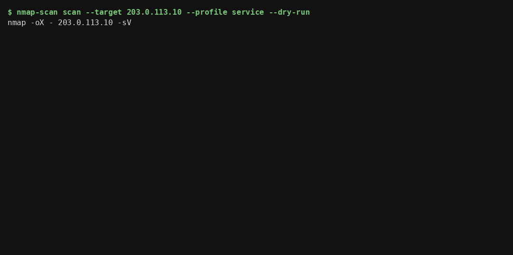
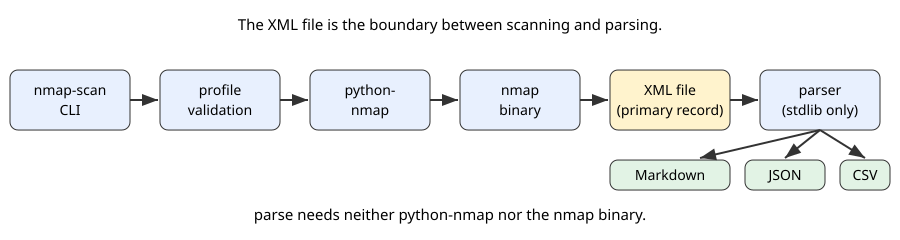
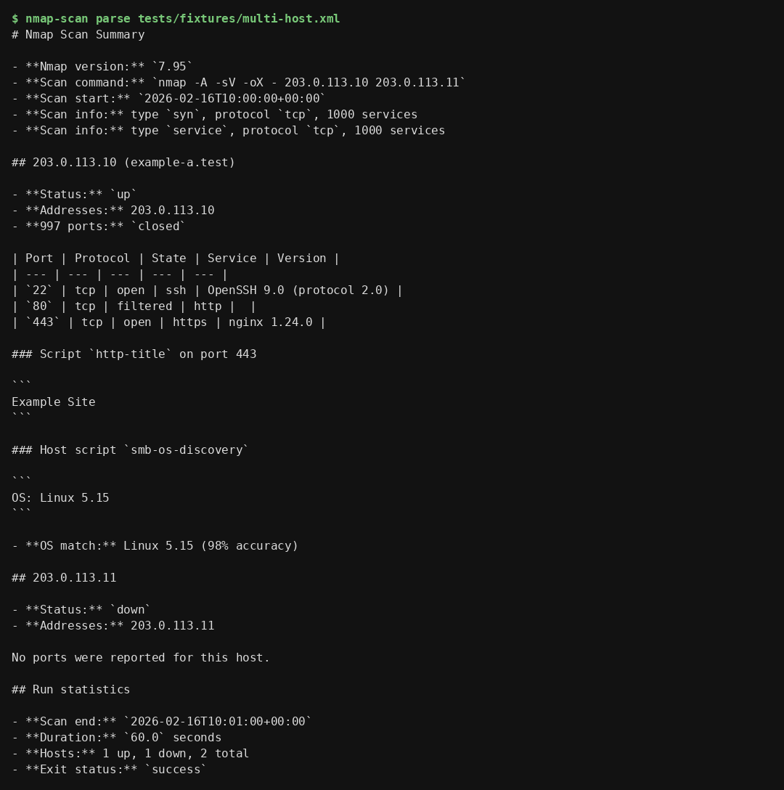

# nmap-scan

[](https://github.com/enonymous1/nmap-scan/actions/workflows/ci.yml)
[](https://www.python.org/downloads/)
[](LICENSE)

Run one Nmap scan and turn Nmap XML output into an honest report.
One command, one scan, and a parser that reports every host it finds —
nothing hardcoded, nothing invented.

> **Only scan systems you own or have explicit permission to scan.**
> Scanning other systems without authorization may be unlawful.
> `nmap-scan` prints this reminder to stderr before every real scan. Use
> `--dry-run` to check a command before it runs.



## Description

`nmap-scan` is a small command-line tool with two jobs:

1. **Scan** — run a single Nmap scan through `python-nmap` and save
   the raw XML. The scan profile is chosen explicitly; nothing
   silently escalates to an aggressive scan.
2. **Parse** — read Nmap XML (from a file or stdin) and render it as
   Markdown, JSON, or CSV. The parser reports every host, every port
   state, service product and version, OS matches, host and port
   script output — only what the XML contains. A down host is reported
   as down; a scan with no open ports says so.

`parse` needs neither the `nmap` binary nor `python-nmap`: it is
standard-library only, so it works on any machine that can run Python.



### What this is not

- Not a vulnerability scanner. It reports what Nmap found; it does
  not assess, score, or exploit anything.
- Not a service. It trusts its operator. Do not expose it (or its
  `--scan-args`) through a web API or queue without an allowlist in
  front of it — see [Security](#security).
- Not a replacement for reading Nmap's own output. The saved XML is
  always the primary record; the Markdown, JSON, and CSV are views
  of it.

## Prerequisites

- **Python 3.10 or later.** Check with `python --version`.
- **The `nmap` binary on PATH — for scanning only.** Parsing works
  without it.
  - Ubuntu/Debian: `sudo apt install nmap`
  - macOS: `brew install nmap`
  - Windows: `choco install nmap`, or the installer from the Nmap
    download page, then ensure `nmap` is on PATH.
- A terminal with PowerShell, bash, or zsh. Examples below use
  PowerShell syntax; the commands are the same on other shells
  except for piping (`Get-Content` vs `cat`).

## Installation

### From PyPI (once published — see Deployment)

```powershell
pip install nmap-scan
nmap-scan --version
```

### From source

```powershell
git clone https://github.com/enonymous1/nmap-scan.git
cd nmap-scan
pip install .
nmap-scan --version
```

Verify the install worked before scanning anything:

```powershell
nmap-scan parse --help
nmap-scan scan --target 127.0.0.1 --dry-run
```

## Usage

### Scan

```powershell
nmap-scan scan --target 203.0.113.10 --output scan-results.xml
```

The default profile uses `-sS` when privileged and `-sT` otherwise.
Pick a profile explicitly instead of relying on the default:

| Profile | Arguments | Notes |
| --- | --- | --- |
| `default` | `-sS` / `-sT` | Privilege-aware, as above |
| `connect` | `-sT` | TCP connect scan, no privileges needed |
| `syn` | `-sS` | SYN scan, needs privileges |
| `service` | `-sV` | Version detection |
| `aggressive` | `-A -sV` | OS detection, scripts, traceroute — requires `--confirm-aggressive` |

```powershell
nmap-scan scan --target 203.0.113.10 --profile service --ports 22,80,443
nmap-scan scan --target 203.0.113.10 --scan-args "-sV -Pn" --timeout 120
# Aggressive scans are intrusive: OS detection, script scanning, and
# traceroute against a whole subnet. Confirm explicitly, and only
# against systems you own or have permission to test:
nmap-scan scan --target 203.0.113.0/24 --profile aggressive --confirm-aggressive
```

Custom `--scan-args` override `--profile`. Nmap output options
(`-oX`, `-oN`, `-oG`, `-oA`, `-oS`, `--append-output`, `--resume`,
including bundled and abbreviated forms) are rejected: this tool
writes the XML itself, and `python-nmap` already forces `-oX -`.
`--dry-run` prints the exact command and runs nothing:

```powershell
nmap-scan scan --target 203.0.113.10 --profile service --dry-run
# nmap -oX - 203.0.113.10 -sV
```

By default a scan also prints a Markdown summary. Use
`--summary-format json|csv|none` and `--summary-output <file>` to
change that. The XML file is the primary record; the summary is a
view of it. `--output` and `--summary-output` overwrite an existing
file without asking, so check before reusing a filename you care about.

### Parse

`parse` reads an existing Nmap XML file (or stdin with `-`) and
renders it as Markdown, JSON, or CSV. It needs no Nmap install:

```powershell
nmap-scan parse scan-results.xml
nmap-scan parse scan-results.xml --format json --output report.json
nmap-scan parse scan-results.xml --format csv --output report.csv
Get-Content scan-results.xml | nmap-scan parse -
```

For large scans, filter before rendering:

```powershell
nmap-scan parse scan-results.xml --open-only
nmap-scan parse scan-results.xml --host 203.0.113.10
```

The report lists every host, every port state (open, filtered, and
closed counts via extraports), service product/version, OS matches,
script output, and run statistics — only what the XML contains.
Run statistics always describe the original scan, even when a filter
is applied. Host scripts appear in Markdown and JSON; CSV rows are
ports, so host scripts are not CSV rows.



### Use it as a library

```python
from nmap_scan import parse_file, scan_to_json

result = parse_file("scan-results.xml")
for host in result.hosts:
    print(host.address, host.status, [p.portid for p in host.open_ports()])
print(scan_to_json(result))
```

Parse errors raise `NmapParseError`; scan failures raise
`NmapScanError`. Neither returns an error string disguised as a result.

### Exit codes

| Code | Meaning |
| --- | --- |
| `0` | Success |
| `1` | A scan ran and failed, or a scan output file could not be written |
| `2` | Usage error (argparse, invalid profile/timeout/indent) or parse input failure |

## Local Development

```powershell
git clone https://github.com/enonymous1/nmap-scan.git
cd nmap-scan
python -m venv .venv
.\.venv\Scripts\Activate.ps1
pip install -e ".[dev]"
pytest -q
ruff check .
mypy src
```

On macOS/Linux, activate with `source .venv/bin/activate` instead
of the PowerShell line above. The test suite itself is
cross-platform, except for the localhost integration test, which is
skipped where the `nmap` binary is not installed.

### Tests and fixtures

- `pytest -q` runs the suite: parser, reporting, scanner (with a
  fake scanner — no Nmap needed), and CLI tests.
- Fixtures live in `tests/fixtures/` and use only fictional
  TEST-NET-3 addresses (RFC 5737). **Do not commit real scan output.**
  If you add a fixture, keep its addresses in `203.0.113.0/24` and
  note in the fixture header that it is fictional.
- To add a test for a new parser behaviour, add the XML to a fixture
  first, then assert on the parsed dataclasses — not on rendered
  strings — so the test survives renderer changes.

### Project layout

```
src/nmap_scan/
  cli.py       # nmap-scan scan / parse
  scanner.py   # one-scan execution, profile resolution, argument validation
  parser.py    # Nmap XML -> dataclasses (all hosts, ports, OS, scripts)
  reporting.py # Markdown / JSON / CSV renderers
tests/
  fixtures/    # fictional TEST-NET-3 (RFC 5737) XML, not real scan results
```

### Contributing

Issues and pull requests are welcome. Please keep the scope small:
one scan per call, explicit profiles, no silent escalation, and no
real scan output in fixtures. Run `pytest -q`, `ruff check .`, and
`mypy src` before opening a PR.

## Deployment

### Releasing a new version

1. Update the version in `pyproject.toml` (the package reads it from
   installed metadata, so there is only one place to change) and add
   a `CHANGELOG.md` entry.
2. Run the full suite and checks: `pytest -q && ruff check . && mypy src`
3. Commit, push, and tag: `git tag vX.Y.Z && git push origin vX.Y.Z`
   (tagging is the release trigger once the PyPI workflow below is
   added; until then, releases are manual).
4. Verify the published package installs cleanly in a fresh
   virtualenv and that `nmap-scan --version` reports the new version.

### Publishing to PyPI (to be added)

The intended path is a tag-triggered workflow: a `vX.Y.Z` tag runs
tests, builds an sdist and a wheel, and publishes with trusted
publishing (OIDC — no API token in repository secrets). Until that
workflow exists, `pip install .` from a clone and
`pip install git+https://github.com/enonymous1/nmap-scan.git` are
the supported install paths, and the README must not claim a PyPI
package that does not exist yet.

### What is deployed where

- The CLI is installed by the user (`pip install nmap-scan` or from
  source). There is no server, no hosted service, and no database.
- GitHub Actions runs tests on Ubuntu and Windows for Python
  3.10–3.13. Both jobs install Nmap so the localhost integration
  test runs; Dependabot updates pip and GitHub Actions weekly.

## Troubleshooting

| Symptom | Likely cause and fix |
| --- | --- |
| `The 'nmap' executable was not found in PATH` | Install Nmap (see Prerequisites) and reopen the terminal so PATH updates |
| `The 'python-nmap' package is required` | Install with dependencies: `pip install nmap-scan` (not `--no-deps`) |
| SYN scan fails or warns about privileges | `-sS` needs privileges. Use `--profile connect` (no privileges needed) or run elevated |
| Aggressive scan refuses to run | Pass `--confirm-aggressive`. This is deliberate |
| `Error: Could not parse Nmap XML` | The file is not Nmap XML, is truncated, or is a partial write from an interrupted scan. Re-run the scan; the saved XML is the record to keep |
| Scan succeeds but summary write fails (exit 1) | The XML was still saved. Check the summary output path and permissions, then re-render with `nmap-scan parse` |
| Very large scans are slow or use a lot of memory | The parser reads the whole XML file. Filter with `--open-only` or `--host` before rendering; a streaming parser is a future change, not a current one |

## Security

- `nmap-scan` trusts its operator. `--scan-args` is operator input.
  Do not expose this tool, or its arguments, through a web service,
  API, or job queue without an allowlist in front of it. See
  [SECURITY.md](SECURITY.md).
- Scan output can contain hostnames, service banners, and script
  output from the scanned systems. Treat saved XML and reports as
  potentially sensitive; do not commit real scan results.
- Report security issues privately (see the repository's Security
  tab) rather than opening a public issue with scan output attached.

## License

MIT. See [LICENSE](LICENSE). See [CHANGELOG.md](CHANGELOG.md) for
what changed in each release.
